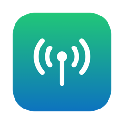

<p align="center">
  
</p>

<h1 align="center">PPPKeeper</h1>

<p align="center">
  <b>Use NetShare with your Mac in one click, and stop the connection from dropping.</b><br>
  A macOS menu bar app for the <a href="https://netshare.app/">NetShare</a> Android app.
  It runs NetShare's Mac setup for you and reconnects automatically whenever the connection drops.
</p>

---

## Why

[NetShare](https://netshare.app/) ([Google Play](https://play.google.com/store/apps/details?id=kha.prog.mikrotik))
shares your Android phone's internet with other devices without using the phone's built-in mobile hotspot.
So **the carrier's hotspot data cap doesn't apply**. Tested on a **Galaxy S25 Ultra on Verizon**.

[NetShare's official Mac setup](https://netshare.app/mac) asks you to paste this into Terminal:

```bash
bash <(curl -s http://192.168.49.1:8181/msh)
```

That works, but in practice:

- 🔌 **The connection drops all the time** (`Connection terminated`,
  `Child process nc 192.168.49.1 8181 … terminated with signal 15`), and you have to rerun the command by hand.
- 🖥️ It ties up a Terminal window, and nothing tells you whether you're still connected.

**PPPKeeper fixes both.** It runs the same command, watches the output, and restarts the connection
as soon as it drops. It keeps doing this until you click Stop. Its status sits in your menu bar.

| Menu bar | Meaning |
|---|---|
| 🟢 `1:02:05` | Connected, showing uptime |
| 🟡 PPP | Connecting… |
| 🟠 PPP | Dropped, reconnecting… |
| ⚪️ PPP | Stopped |

## Features

- **One-click Start / Stop** from the menu bar, and a password prompt only once per start
- **Auto-reconnect** whenever the PPP link dies or the setup command exits
- **Live uptime counter** in the menu bar
- **Open at Login** and **Connect Automatically on Open** settings, so it's hands-free on boot
- **Show Log** opens the full pppd output in Console
- Native, tiny, no dependencies, universal binary (Apple Silicon + Intel), macOS 13 Ventura or newer

## Setup

1. Install **NetShare** on your Android phone and start sharing.
2. On your Mac, join NetShare's Wi-Fi network (the name and password are shown in the app).
3. Install PPPKeeper (below), click **⚪️ PPP → Start** and enter your Mac password.

### Install

**Option A: download.** Grab `PPPKeeper.zip` from [Releases](../../releases/latest), unzip it and drag
`PPPKeeper.app` into **Applications**. It then shows up in Launchpad.
The app isn't notarized, so the first time you open it, right-click it and choose **Open**. If macOS still blocks it, run:

```bash
xattr -dr com.apple.quarantine /Applications/PPPKeeper.app
```

**Option B: build from source.** You need the Xcode Command Line Tools (`xcode-select --install`).

```bash
git clone https://github.com/pouriarad/PPPKeeper.git
cd PPPKeeper
./PPPKeeper/build.sh --install
```

This builds the app, copies it to `/Applications`, and opens it.

### Run at startup

Open the menu bar item and turn on:
- **Open at Login**: launches PPPKeeper when you log in.
- **Connect Automatically on Open**: starts connecting right away. You'll be asked for your password.

### Without the menu bar app

```bash
sudo ./PPPKeeper/keeper.sh
```

This shows the same auto-reconnect loop in Terminal. Press Ctrl+C to stop.

## How it works

`keeper.sh` runs `bash <(curl -s http://192.168.49.1:8181/msh)`, NetShare's own setup script, as root,
because pppd needs root. It writes the output to a log and checks it every second. When it sees
`terminated with signal 15` or `Connection terminated`, or the command exits, it kills the old
pppd/nc processes and starts again 3 seconds later. The menu bar app starts the script through the standard
macOS administrator prompt and reads its status from `~/Library/Application Support/PPPKeeper/`.

| File | Purpose |
|---|---|
| `PPPKeeper/keeper.sh` | Reconnect loop |
| `PPPKeeper/main.swift` | Menu bar app (AppKit) |
| `PPPKeeper/icon.swift` | Generates the app icon |
| `PPPKeeper/build.sh` | Builds and optionally installs `PPPKeeper.app` |

## Troubleshooting

- **Stuck on 🟡 Connecting.** Check that your Mac is on NetShare's Wi-Fi and that sharing is on in the app.
  Try `curl http://192.168.49.1:8181/msh` in Terminal.
- **`publish_entry SCDSet() failed` / `ioctl (SIOCSIFMTU)` in the log.** These are harmless pppd messages on recent macOS.
- **Open at Login fails.** Add PPPKeeper manually in System Settings → General → Login Items.

## Disclaimer

PPPKeeper isn't affiliated with NetShare. It just automates NetShare's public Mac setup command.
Using tethering workarounds may violate your carrier's terms of service. Use it at your own risk.

## Keywords

NetShare Mac · NetShare macOS setup · NetShare MacBook · bypass hotspot limit · tethering without hotspot ·
Android to Mac internet sharing · Wi-Fi Direct PPP · Verizon hotspot cap · Galaxy S25 Ultra tethering ·
NetShare connection keeps dropping · `192.168.49.1:8181/msh`
